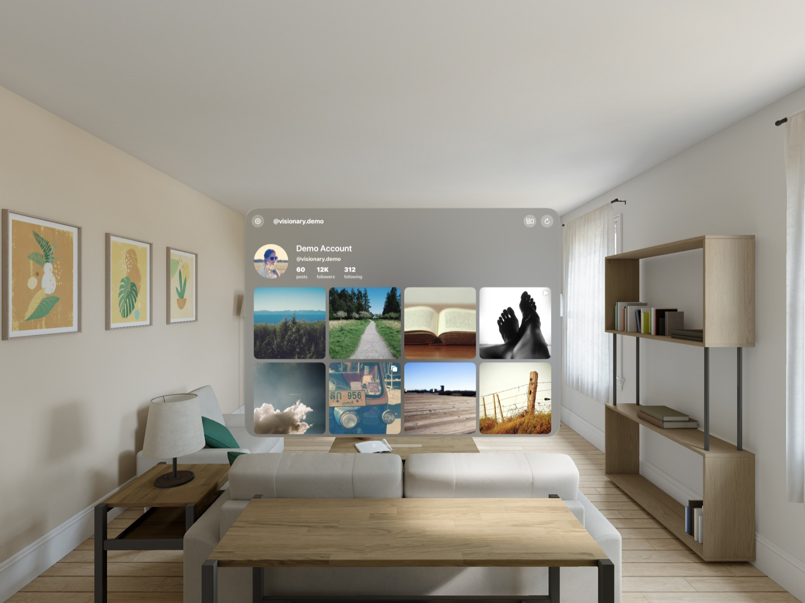

# InstaVision

[](https://github.com/pballada/instavision/actions/workflows/ci.yml)

A native Instagram viewer for **Apple Vision Pro**, built with SwiftUI and RealityKit.



> Not affiliated with, endorsed by, or sponsored by Instagram or Meta.

## Features

- **Feed grid** with profile header, infinite scroll, pull to refresh and gaze hover effects
- **Posts in their own windows**: open as many as you like and arrange them around the room
- **Carousel albums** with paging, and **video** playback with AVKit
- **Gallery Wall**: an immersive space that hangs your 16 latest posts on a curved wall around you. Look and pinch to open one
- **Demo mode** to try everything without an account
- Token stored in the **Keychain** and **refreshed automatically** before it expires
- Memory and disk **image cache** that survives Instagram's rotating CDN URLs

## Requirements

- Xcode 16 or later with the visionOS SDK
- visionOS 2.0 or later (device or Simulator)
- For live data: an Instagram **professional** account (Business or Creator)

## Getting started

```sh
git clone https://github.com/pballada/instavision.git
open instavision/InstaVision.xcodeproj
```

Choose the **InstaVision** scheme and an Apple Vision Pro destination, then run. Tap **Try the Demo** to explore with sample data, or launch with the `--demo` argument to skip the welcome screen.

### Using your own account

InstaVision uses the [Instagram API with Instagram Login](https://developers.facebook.com/docs/instagram-platform/instagram-api-with-instagram-login).

1. Create an app at [developers.facebook.com](https://developers.facebook.com/apps) and add the **Instagram** product.
2. Under **API setup with Instagram login**, add your Instagram account as a tester and accept the invite in Instagram.
3. Click **Generate token** next to your account and copy the long-lived token.
4. Paste the token on InstaVision's welcome screen.

The token is kept in the Keychain and refreshed once a day while you use the app, so it won't hit its 60-day expiry as long as you open the app now and then.

## Project layout

| Path | What's there |
| --- | --- |
| `InstaVision/` | The visionOS app: scenes, views and `AppSession` |
| `InstaVision/Immersive/` | RealityKit gallery wall |
| `Packages/InstaVisionKit/` | Models, Graph API client, Keychain store, token refresh, feed store, image cache, layout math |

Everything that doesn't need UIKit or RealityKit lives in `InstaVisionKit` and is tested on macOS:

```sh
cd Packages/InstaVisionKit && swift test
```

## License

[MIT](LICENSE)
